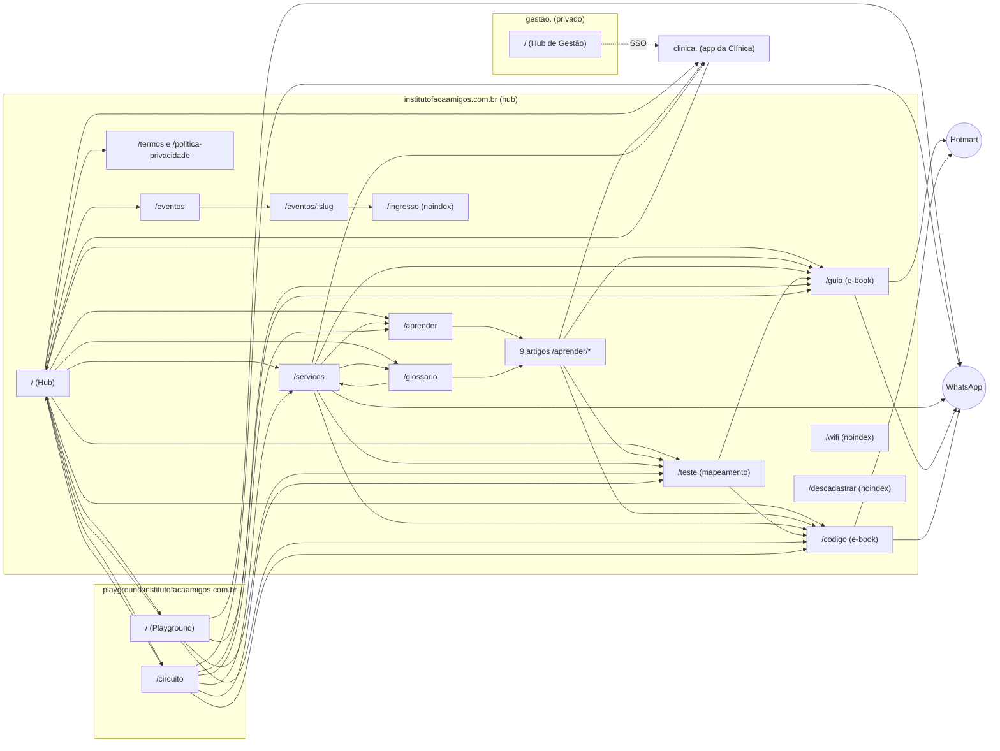

# Mapa do site FaçaAmigos

Atualizado em 30/09/2026, a partir do código do repositório (não foi conferido no ar).

## 1. Domínios e quem serve o quê

| Domínio | O que é | Onde vive | Indexa? |
|---|---|---|---|
| `institutofacaamigos.com.br` | Hub: institucional, conteúdo, funil de e-books, eventos, Wi-Fi | este repositório (Vercel) | sim |
| `playground.institutofacaamigos.com.br` | Playground e Circuito | este repositório (mesmo deploy) | sim |
| `gestao.institutofacaamigos.com.br` | Hub de Gestão (login único, só Bruno e Isabella) | este repositório (mesmo deploy) | não (noindex + robots Disallow) |
| `clinica.institutofacaamigos.com.br` | Site e sistema da Clínica | projeto "Clinica Faça Amigos" (Next.js) | site público sim; áreas logadas não |
| `sistema.institutofacaamigos.com.br` | Sistema citado no código da Clínica | não verificado aqui | ? |

Regra de "dono" (aplicada em `middleware.js`): o `playground.` só serve a home do Playground e o `/circuito`.
Qualquer outro caminho redireciona (308) para o hub. No hub, `/playground` e `/circuito` redirecionam para o `playground.`.
Arquivos (`.txt`, `.xml`, `.ico`, `.well-known`) passam em qualquer host.

## 2. Diagrama de navegação

## 3. Páginas do hub (institutofacaamigos.com.br)

| Rota | Arquivo | Papel | No sitemap | Observação |
|---|---|---|---|---|
| `/` | index.html | Hub: porta de entrada para Playground, Circuito, Clínica, guias, carreiras | sim | seção de próximos eventos |
| `/servicos` | servicos.html | Serviços da Clínica, FAQ, lista de espera | sim | CTA para o site da Clínica |
| `/aprender` | aprender.html | Índice de artigos | sim | |
| `/aprender/*` (9) | aprender/*.html | Artigos: birra-ou-crise, sinais-para-observar, primeira-vez-no-playground, rotina-visual-em-casa, como-e-a-terapia-comportamental, laudo-e-ciptea, conversar-com-a-escola, brincar-com-proposito-10-minutos, e-para-todas-as-criancas | sim | cada um leva ao /teste, à Clínica e ao WhatsApp |
| `/glossario` | glossario.html | Termos explicados | sim | |
| `/teste` | teste.html | Mapeamento comportamental (funil principal) | sim | perguntas em `teste-perguntas.json` |
| `/guia` | guia.html | E-book "O Brincar com Propósito" (capítulo grátis + Hotmart) | sim | |
| `/codigo` | codigo.html | E-book "O Código do Desenvolvimento Infantil" (Hotmart) | sim | |
| `/eventos` | eventos.html | Lista de encontros, palestras e treinamentos | sim | dados vêm da função `eventos-public` |
| `/eventos/:slug` | evento.html | Detalhe e inscrição | não | `vercel.json` reescreve para `/evento`; canonical aponta para `/eventos` |
| `/ingresso` | ingresso.html | Voucher com QR do inscrito | não | noindex, Disallow no robots |
| `/wifi` | wifi.html | Portal do Wi-Fi da clínica | não | noindex, follow |
| `/termos` | termos.html | Termos de uso e de compra | sim | |
| `/politica-privacidade` | politica-privacidade.html | LGPD | sim | dono: hub |
| `/descadastrar` | descadastrar.html | Sair da sequência de e-mails | não | noindex |
| `/admin` | admin.html | Painel do teste | não | noindex, no-store |
| `/gestao` | gestao.html | Hub de Gestão | não | só pelo host `gestao.` |
| `/404` | 404.html | Erro | não | links para home, circuito, guia, código, playground, teste |

## 4. Páginas do playground.

| Rota | Arquivo | Observação |
|---|---|---|
| `/` | playground.html | reescrito pelo middleware; canonical em `playground.` |
| `/circuito` | circuito.html | canonical em `playground.` |

## 5. Arquivos técnicos e de descoberta

`robots.txt`, `robots-gestao.txt` (host gestao.), `sitemap.xml`, `llms.txt`, `llms-full.txt`, `geo-facts.json`
(fatos do quiosque para IAs), `site.webmanifest`, `favicon.ico`, `apple-touch-icon.png`,
`google877c2b37d3c979fb.html` (verificação do Search Console).

## 6. Backend (Supabase `ivjvpdzsfjdpyabbzzuj`)

Funções: `behavior-test-webhook`, `behavior-test-admin`, `guia-sequence`, `hotmart-webhook`, `hotmart-sync`,
`wifi-lead-webhook`, `wifi-coupon-admin`, `geo-facts`, `fa-health`, `fa-weekly-report`, `gestao-hub`,
`eventos-public`, `eventos-dispatch`.

## 7. Como o visitante circula (jornadas)

1. **Pai/mãe que chega pelo Google:** artigo em `/aprender/*` → `/teste` → `/guia` ou `/codigo` (Hotmart) ou WhatsApp.
2. **Quem está no shopping (Maps/Instagram):** `playground.` → guia/código/teste ou WhatsApp; o botão "Instituto FaçaAmigos" leva ao hub.
3. **Quem procura terapia:** `/servicos` → lista de espera (WhatsApp) ou site da Clínica.
4. **Quem se inscreve em evento:** hub (seção de eventos) → `/eventos` → `/eventos/:slug` → voucher em `/ingresso`.
5. **Equipe:** `gestao.` → login único → Clínica e demais sistemas via `/sso`.

## 8. Pontos de atenção (28 a 30/09/2026)

- `npm run geo:check` acusa `llms.txt` e `llms-full.txt` divergentes do preço atual do quiosque. Rodar `npm run geo`,
  revisar o diff e commitar.
- `/eventos/:slug` tem canonical para `/eventos`, então os detalhes de evento não são indexados individualmente.
  Se a ideia é ranquear cada evento, cada um precisa do próprio canonical.
- Falta confirmar o destino de `sistema.institutofacaamigos.com.br`.
- O app da Clínica ainda linka para `institutofacaamigos.com.br/playground` (redireciona, mas convém apontar direto).
