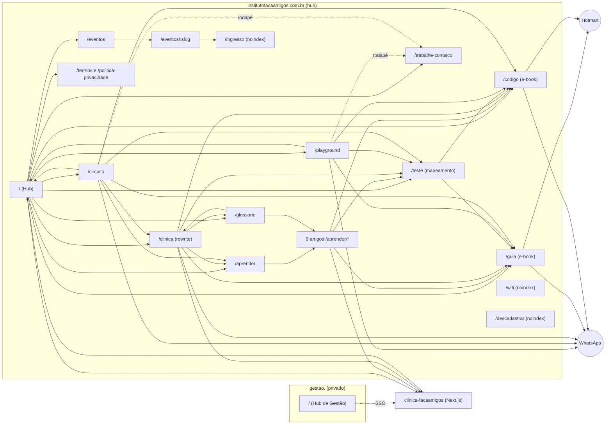

# Mapa do site FaçaAmigos

Atualizado em 30/09/2026, a partir do código do repositório (não foi conferido no ar).

## 1. Domínios e quem serve o quê

| Domínio | O que é | Onde vive | Indexa? |
|---|---|---|---|
| `institutofacaamigos.com.br` | Hub: institucional, conteúdo, funil de e-books, eventos, Wi-Fi | este repositório (Vercel) | sim |
| `playground.institutofacaamigos.com.br` | Host antigo: só redireciona (308) para `/playground` e `/circuito` do hub. Nunca remover o domínio | este repositório (mesmo deploy) | não (redireciona) |
| `gestao.institutofacaamigos.com.br` | Hub de Gestão (login único, só Bruno e Isabella) | este repositório (mesmo deploy) | não (noindex + robots Disallow) |
| `institutofacaamigos.com.br/clinica` | Landing pública da Clínica (serviços, lista de espera, convênios) | projeto `clinica-facaamigos` (Next.js); o hub faz rewrite de `/clinica` e `/clinica-static/*` (vercel.json) | sim |
| `clinica.institutofacaamigos.com.br` | Host antigo da landing: só redireciona (301) para `/clinica`; o resto vai (308) para `sistema.` | projeto `clinica-facaamigos` | não (redireciona). Manter o domínio apontado |
| `sistema.institutofacaamigos.com.br` | Sistema de gestão da Clínica (login, agenda, prontuário, portal da família) | projeto `clinica-facaamigos` | nunca (noindex, robots Disallow, sem link nas páginas públicas) |

Desde 09/10/2026 o Playground e o Circuito moram no hub (`/playground` e `/circuito`). O `middleware.js` faz o host
`playground.` redirecionar (308) tudo para o hub (`/` vira `/playground`; o resto mantém o caminho e a query).
Arquivos (`.txt`, `.xml`, `.ico`, `.well-known`) passam em qualquer host; `playground./sitemap.xml` serve o
`sitemap-playground.xml`, de transição (URLs antigas, para o Google enxergar os redirecionamentos; pode sair ~3 meses depois).

## 2. Diagrama de navegação

## 3. Páginas do hub (institutofacaamigos.com.br)

| Rota | Arquivo | Papel | No sitemap | Observação |
|---|---|---|---|---|
| `/` | index.html | Hub: porta de entrada para Playground, Circuito, Clínica, guias, carreiras | sim | seção de próximos eventos |
| `/trabalhe-conosco` | trabalhe-conosco.html | Carreiras: áreas, tipos de vaga e formulário de candidatura com currículo em PDF | sim | envia para a função `job-application-webhook` (mesmo endpoint do antigo modal); no `playground.` redireciona (308) para o hub |
| `/playground` | playground.html | Playground Inclusivo (antes em `playground.`) | sim | canonical no hub |
| `/circuito` | circuito.html | Circuito de Carrinhos (antes em `playground.`) | sim | canonical no hub |
| `/clinica` | (projeto clinica-facaamigos) | Landing da Clínica: serviços detalhados, ambiente, convênios, FAQ, lista de espera | sim | rewrite para o app da Clínica; `/servicos` redireciona (301) para cá |
| `/aprender` | aprender.html | Índice de artigos | sim | |
| `/aprender/*` (9) | aprender/*.html | Artigos: birra-ou-crise, sinais-para-observar, primeira-vez-no-playground, rotina-visual-em-casa, como-e-a-terapia-comportamental, laudo-e-ciptea, conversar-com-a-escola, brincar-com-proposito-10-minutos, e-para-todas-as-criancas | sim | cada um leva ao /teste, à Clínica e ao WhatsApp |
| `/glossario` | glossario.html | Termos explicados | sim | |
| `/teste` | teste.html | Mapeamento comportamental (funil principal) | sim | perguntas em `teste-perguntas.json` |
| `/guia` | guia.html | E-book "O Brincar com Propósito" (capítulo grátis + Hotmart) | sim | |
| `/codigo` | codigo.html | E-book "O Código do Desenvolvimento Infantil" (Hotmart) | sim | |
| `/eventos` | eventos.html | Lista de encontros, palestras e treinamentos | sim | dados vêm da função `eventos-public` |
| `/eventos/:slug` | evento.html | Detalhe e inscrição | não | `vercel.json` reescreve para `/evento`; canonical aponta para `/eventos` |
| `/ingresso` | ingresso.html | Voucher com QR do inscrito | não | noindex, Disallow no robots |
| `/wifi` | wifi.html | Portal do Wi-Fi da clínica | não | noindex, follow |
| `/termos` | termos.html | Termos de uso e de compra | sim | |
| `/politica-privacidade` | politica-privacidade.html | LGPD | sim | dono: hub |
| `/descadastrar` | descadastrar.html | Sair da sequência de e-mails | não | noindex |
| `/admin` | admin.html | Painel do teste | não | noindex, no-store |
| `/gestao` | gestao.html | Hub de Gestão | não | só pelo host `gestao.` |
| `/tv` | tv.html | Vitrine Digital e canal de cultura para as Smart TVs das operações (/vitrine-digital) | não | noindex (uso interno nas lojas). Tecla G = Jogos FaçaAmigos para 2 gamepads Bluetooth; `/tv?jogos=teste` mostra os controles detectados |
| `/tv2` | tv2.html | Vitrine Digital da TV 50" deitada 90º (retrato) do Quiosque do Circuito — só carrinhos, preço R$ 48,00 · 20/30 min | não | noindex (uso interno quiosque) |
| `/404` | 404.html | Erro | não | links para home, circuito, guia, código, playground, teste |

## 4. Arquivos técnicos e de descoberta

`robots.txt`, `robots-gestao.txt` (host gestao.), `sitemap.xml` (todas as URLs, inclusive /playground e /circuito), `sitemap-playground.xml` (transição, servido como /sitemap.xml no host antigo playground.), `llms.txt`, `llms-full.txt`, `geo-facts.json`
(fatos do quiosque para IAs), `site.webmanifest`, `favicon.ico`, `apple-touch-icon.png`,
`google877c2b37d3c979fb.html` (verificação do Search Console).

## 5. Backend (Supabase `ivjvpdzsfjdpyabbzzuj`)

Funções: `behavior-test-webhook`, `behavior-test-admin`, `guia-sequence`, `hotmart-webhook`, `hotmart-sync`,
`wifi-lead-webhook`, `wifi-coupon-admin`, `geo-facts`, `fa-health`, `fa-weekly-report`, `gestao-hub`,
`eventos-public`, `eventos-dispatch`, `job-application-webhook` (candidaturas do /trabalhe-conosco).

## 6. Como o visitante circula (jornadas)

1. **Pai/mãe que chega pelo Google:** artigo em `/aprender/*` → `/teste` → `/guia` ou `/codigo` (Hotmart) ou WhatsApp.
2. **Quem está no shopping (Maps/Instagram):** `/playground` → guia/código/teste ou WhatsApp; o botão "Instituto FaçaAmigos" leva ao hub.
3. **Quem procura terapia:** `/clinica` → lista de espera (WhatsApp).
4. **Quem se inscreve em evento:** hub (seção de eventos) → `/eventos` → `/eventos/:slug` → voucher em `/ingresso`.
5. **Quem quer trabalhar no FaçaAmigos:** link "Faça parte do nosso time" (rodapé de todas as páginas via `fa-footer.js`, topo do playground) → `/trabalhe-conosco` → candidatura → e-mail com o teste de perfil comportamental.
6. **Equipe:** `gestao.` → login único → Clínica e demais sistemas via `/sso`.

## 7. Pontos de atenção (28/09 a 08/10/2026)

- 08/10/2026: o formulário "Faça parte do nosso time" saiu dos modais (`#jobModalOverlay`) do playground e do circuito e virou a
  página `/trabalhe-conosco`. Os links do playground/circuito e do rodapé (`fa-footer.js`) apontam para
  `https://institutofacaamigos.com.br/trabalhe-conosco`. `assets/fa-modal.js` foi removido (nenhuma página tem mais modal).

- `npm run geo:check` acusa `llms.txt` e `llms-full.txt` divergentes do preço atual do quiosque. Rodar `npm run geo`,
  revisar o diff e commitar.
- `/eventos/:slug` tem canonical para `/eventos`, então os detalhes de evento não são indexados individualmente.
  Se a ideia é ranquear cada evento, cada um precisa do próprio canonical.
- Falta confirmar o destino de `sistema.institutofacaamigos.com.br`.
- 09/10/2026: `playground.` virou só redirecionamento. Pendências fora do código: (1) Search Console: conferir se a propriedade
  é de domínio; se for de prefixo, criar a do domínio principal e enviar o `sitemap.xml`; (2) trocar o link do site no Google Meu
  Negócio, na bio do Instagram e nos anúncios (Google/Meta) para `https://institutofacaamigos.com.br/playground`; (3) a lista de
  CORS das Edge Functions do Supabase ainda tem o host antigo (inofensivo; remover quando o redirecionamento sair).
