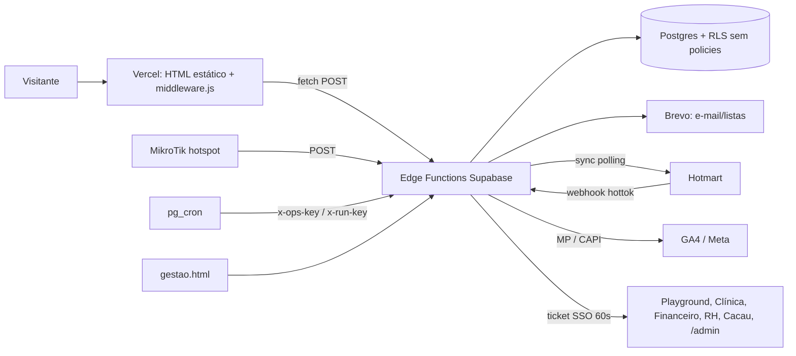

# CODEBASE MAP: langing_page_faca_amigos

> Gerado em 2026-10-03 por leitura paralela (5 subagentes), seguindo o fluxo do plugin Cartographer. Retrato do estado da branch `claude/upbeat-goldberg-qbt89i`.
> Limites: `admin.html`, `teste.html`, `gestao.html` e `llms-full.txt` foram lidos por estrutura e trechos, não linha a linha. As migrations dos quiosques (`fa_kiosk_*`) não estão neste repo.
> Complementa (não substitui) `PUBLICAR.md` (mais atual, manda no deploy), `LEIA-ME.txt` (diário cronológico, parte obsoleta) e `MAPA-DO-SITE.md`.

## 1. Visão geral

Site **estático** (HTML/CSS/JS puro, sem build) publicado na Vercel, com backend em **Supabase** (projeto `ivjvpdzsfjdpyabbzzuj`). Um único deploy atende vários hosts:

| Host | Serve |
|---|---|
| `institutofacaamigos.com.br` (hub) | `index.html`, guia, codigo, teste, servicos, aprender, glossario, eventos, termos, política |
| `playground.institutofacaamigos.com.br` | `/` (= `playground.html`) e `/circuito` |
| `gestao.` e `clinica.institutofacaamigos.com.br` | `/` → `gestao.html` (Hub de Gestão, noindex) |

A Clínica (Next.js) e os demais sistemas são **outros repositórios**.



Deploy: push na `main` publica na Vercel. **Funções e migrations não vão pela Vercel**, vão pela CLI do Supabase. Ordem: migration → função → site.

## 2. Estrutura de diretórios

```
/ (raiz servida pela Vercel)
├── index.html            hub do Instituto
├── playground.html       Playground (host playground.)
├── circuito.html         Circuito de carrinhos (host playground.)
├── servicos.html         Clínica / serviços
├── teste.html            funil do Mapeamento Comportamental (+ teste-perguntas.json)
├── guia.html, codigo.html     landings dos e-books (Hotmart)
├── eventos.html, evento.html, ingresso.html, descadastrar.html   módulo de eventos
├── aprender.html + aprender/*.html (9 artigos), glossario.html   conteúdo/SEO
├── wifi.html             página pós-portal Wi-Fi (noindex)
├── admin.html            painel privado (leads, textos, cupons Wi-Fi, eventos)
├── gestao.html           Hub de Gestão (login + 7 atalhos SSO)
├── termos.html, politica-privacidade.html, 404.html
├── assets/               fa-track.js, fa-footer.js, fa-cta.js, fa-modal.js
├── img/, downloads/      mídia pública (downloads/ tem o capítulo 1 grátis)
├── middleware.js, vercel.json, package.json, .vercelignore, .gitignore
├── robots.txt, robots-gestao.txt, sitemap.xml, llms*.txt, geo-facts.json, site.webmanifest
├── scripts/              check.mjs, geo-build.mjs (+ geo-templates/), sitemap-lastmod.mjs, bing-submit.mjs
├── supabase/             functions/ (14), migrations/ (20), ops/, email-templates/
├── hotspot/              portal cativo MikroTik (NÃO publicado)
├── conteudo/             kit de marketing interno (NÃO publicado)
├── _arquivo/             imagens não usadas (NÃO publicado)
└── .github/workflows/    check.yml, auto-publicar.yml, geo-sync.yml
```

`.vercelignore` (não vão ao ar): `ebook/`, `Teste de Comportamento/`, `hotspot/`, `supabase/`, `scripts/`, `.github/`, `PUBLICAR.md`, `LEIA-ME.txt`, `conteudo/`, `_arquivo/`, `MAPA-DO-SITE.md`. **`ebook/` (PDFs pagos) precisa ficar nos dois ignore-files**, senão o produto vira público.

## 3. Roteamento, headers e segurança de borda

- **`middleware.js`** (Routing Middleware, tudo em try/catch que cai em `next()`):
  - playground.: `/` → rewrite `/playground`; `/playground` → 308 `/`; `/circuito` e arquivos passam; resto → 308 para o hub.
  - hub: `/playground` e `/circuito` → 308 para o subdomínio playground.
  - gestao./clinica.: `/` → `/gestao`, `/robots.txt` → `robots-gestao.txt`, tudo com `X-Robots-Tag: noindex...`. O resto do site (inclusive `/admin`) também é alcançável nesses hosts.
  - Não usar `has:[{type:"host"}]` em rewrites do `vercel.json` (não existe na API).
- **`vercel.json`**: `cleanUrls`, rewrite `/eventos/:slug` → `/evento`, HSTS e demais headers, **CSP apenas Report-Only**, `no-store` + noindex em `/admin`, `/gestao`, `/ingresso`; cache de 1h em `llms*.txt`, `geo-facts.json` (CORS `*`), sitemap, robots; `/img` `/assets` `/video` com 1 dia + SWR.
- **robots.txt**: libera bots de IA de propósito; bloqueia `/admin`, `/gestao`, `/teste-perguntas.json`, `/wifi`, `/ingresso`, `/hotspot`.

## 4. Camada de front-end compartilhada (`assets/`)

| Arquivo | Função | Pontos de atenção |
|---|---|---|
| `fa-track.js` | **Primeira linha do `<head>`, antes do charset** (não mover). Consent Mode v2 (tudo `denied`; `fa_consent` = `all`/`essential`), GTM `GTM-PN5D2BTS`, GA4 `G-37G5XLBXKG` direto, Clarity só com aceite. Guarda origem (utm_*, gclid, fbclid, src, sck, referrer, IA) em cookie `fa_origin` no domínio raiz. Expõe `faTrack()`, `faOrigin()`, `faAeoMetrics()`, `faConsentOpen()`. Eventos: `whatsapp_click`, `begin_checkout`, `file_download`, `scroll_depth`. Passa `xcod=ga.<client_id>` ao checkout Hotmart. | Mapa `CHECKOUTS` tem os preços (guia R$149, código R$47). O preço do código só existe aqui. IDs de GTM duplicados no HTML. `check.mjs` reprova 2º container GTM. |
| `fa-footer.js` | Rodapé único via `<footer data-fa-footer="hub\|playground\|circuito\|teste\|servicos\|aprender\|glossario\|eventos">`. Constantes `CLINICA_STATUS`, `GRAOPARA_STATUS` (linhas 10-11) controlam o "Em breve". | `guia.html` e `codigo.html` têm footer próprio e não recebem mudanças daqui. JS diz "Av. Augusto Montenegro", HTML/schemas dizem "Rod.". |
| `fa-cta.js` | Barra fixa mobile (≤760px). Lê `data-label`, `data-href` (ou `whatsapp`), `data-event` do próprio `<script>`. | Depende de `.wa-float` na página. Não pode ser carregado por módulo/dinâmico. |
| `fa-modal.js` | Acessibilidade de `.modal-overlay` (foco preso, Esc, `inert`). | Usado em index, playground, circuito. |

**Convenções de página:** CSS inline por página (sem folha compartilhada); duas paletas (hub/clínica: petrol `#065264`; playground/circuito: rosa `#F0196B`); `.fx` + IntersectionObserver para reveal; `<a class=skip>` + `<main id=conteudo>`; links internos sem `.html`, apontando direto para o host dono da página; todo texto em pt-BR; sem "1º/maior/melhor" sem fato público; sem `AggregateRating` inventado; nome do instrumento-base do teste nunca em texto público.

WhatsApp: Clínica `5591991782027`, Playground/Circuito `5591992347673`. Não misturar (mapeado em `fa-track.js` e duplicado em `fa-footer.js`).

## 5. Páginas

### Públicas / marketing
- **index.html** (hub): JSON-LD `@graph` único (Organization, MedicalBusiness, LocalBusiness x3, FAQPage 9 perguntas), reviews hardcoded, `#eventos` preenchido por `eventos-public` (`listar`), modal de vagas → `job-application-webhook`.
- **playground.html**: JSON-LD com 8 Offers; preços duplicados entre schema, tabela e cards; Bosque Grão-Pará aparece no schema como negócio ativo mas é "Em breve"; passaporte mensal fora do schema. Mesmos `@id` do hub (mudar um quebra o outro).
- **circuito.html**: R$48 (20/30 min), minuto adicional R$3, 10ª entrada grátis por CPF. Única página com URLs absolutas para o hub; canonical no host playground.
- **servicos.html**: serviços da Clínica, lista de espera por WhatsApp, JSON-LD com 7 serviços.
- **wifi.html** (noindex): pós-portal; monta UTMs; cupom +15 dias calculado no cliente; avaliação Google só a partir da 3ª visita (`localStorage`).
- **termos / politica-privacidade**: datas fixas (20/09/2026); texto de cookies precisa acompanhar `fa-track.js`.

### Produtos (Hotmart)
- **guia.html**: "O Brincar com Propósito", R$149 (10x R$17,91), checkout direto `pay.hotmart.com/M107692257Y` (não usar `go.hotmart.com`), eventos `guia_*`, Pixel Meta opcional (`metaPixelId` vazio).
- **codigo.html**: "O Código do Desenvolvimento Infantil", checkout `V107698297N?checkoutMode=2` com widget Hotmart; MutationObserver recupera o botão se o widget apagar o link. Sem preço visível na página.

### Funil do teste
- **teste.html** (SPA, 4 passos) carrega `/teste-perguntas.json` (v `2026-09-18`, 25 perguntas, escala 0-2) e chama `behavior-test-webhook` (`start`/`complete`). **Sincronia manual obrigatória**: `version` do JSON = `TEST_VERSION` do webhook; IDs q01..q25 no webhook e em `QUESTION_LABELS_BY_VERSION` do admin; `AGE_RANGES`; áreas/textos/`CONFIG_DEFAULTS`. Divergência de versão → 409.

### Eventos
- **eventos.html** (lista) e **evento.html** (detalhe + inscrição, slug do path) usam `eventos-public`; **ingresso.html** (`?t=token`, noindex) mostra QR/cancelamento/promoção; **descadastrar.html** chama `eventos-dispatch` ou `guia-sequence`.
- A lógica de vagas/escassez vem toda do servidor.

### Conteúdo/SEO
- **aprender.html** + 9 artigos (template idêntico; script inline só muda o `slug`), **glossario.html** (41 termos com âncoras públicas referenciadas pelos artigos e pelo JSON-LD; novo termo = editar div, JSON-LD e nav de letras). Contagens "9 guias" e "cerca de 40 termos" são manuais.
- Roteamento de CTA por tema: comportamento→`/teste`; brincar/rotina→e-books; terapia/escola→lista de espera da clínica; playground/direitos→playground.

### Áreas privadas
- **gestao.html**: login (CPF/e-mail + senha + código de 6 dígitos por e-mail) → `gestao-hub`. 7 tiles (`playground, clinica, financeiro, rh, cacau, painel, eventos`). Token em `localStorage` (`fa_gestao_token`).
- **admin.html** (2837 linhas): abas Leads / Textos / Cupons Wi-Fi / Eventos. APIs `behavior-test-admin` e `eventos-admin` com Bearer. Escopo `owner`|`equipe`: `.owner-only` é só CSS, a barreira real é o servidor. SSO via `/admin#sso=<64hex>[&aba=eventos]` (fragmento apagado com `replaceState`).

## 6. Edge Functions (`supabase/functions/*/index.ts`, Deno)

Padrões comuns: `Deno.serve` único roteado por `action`; CORS e helpers copiados em cada função (deploy via MCP não resolve `../_shared`); **`verify_jwt` desligado** (`--no-verify-jwt`, sem `config.toml`); todas usam **service role** (ignoram RLS); e-mail via **Brevo**; dependência `jsr:@supabase/supabase-js@2`. Proteção real: honeypot, rate limit por IP (`x-forwarded-for`, forjável), tokens HMAC, `x-ops-key`, sessão própria.

| Função | Papel | Auth | Tabelas/RPCs principais |
|---|---|---|---|
| `behavior-test-webhook` | Funil `/teste`: `start`/`complete`, score no servidor, e-mails, oferta de e-book | Pública (honeypot, 10/h por IP) | `fa_leads_teste_comportamento`, `fa_teste_config` |
| `behavior-test-admin` | Backend do `/admin`: login (Auth da Clínica), SSO, leads, CSV, insight Gemini, config, cupons Wi-Fi | login/`sso` sem sessão; resto Bearer em `fa_teste_admin_sessions` | leads, config, `fa_wifi_leads`, `fa_kiosk_coupons`, sessões, tickets |
| `eventos-public` | listar/detalhe/inscrever/ingresso/cancelar/confirmar_promocao | Pública + token HMAC (`EVENTOS_SECRET`) | `fa_eventos*`, view `fa_eventos_publicos`, RPCs `fa_eventos_*` |
| `eventos-admin` | CRUD de eventos/tipos/inscrições, check-in, dashboard, reprocessar Hotmart | Bearer (mesma sessão do admin); equipe só lista/checkin | `fa_eventos*`, `fa_hotmart_eventos` |
| `eventos-dispatch` | Único emissor dos 8 e-mails de eventos; `run` (cron 30 min): expira promoções, drena fila, lembretes, pós-evento; `descadastrar` | `x-ops-key` (`run`/`enviar`); token HMAC (`descadastrar`) | `fa_eventos_envios`, RPC `fa_eventos_expirar_promocoes` |
| `gestao-hub` | Login único do Hub, 2FA por e-mail, reset de senha da Clínica, `launch` (tickets SSO) | Senha (projeto Clínica) + código; Bearer 7 dias | `fa_gestao_*`; `auth.admin` de **dois** projetos |
| `guia-sequence` | 3 e-mails (24h/72h/144h) pós-resultado; descadastro | `x-run-key` (`SEQ_RUN_KEY`); HMAC (`SEQ_SECRET`) | leads, `fa_teste_ebook_seq`, `fa_ebook_compras` |
| `hotmart-webhook` | Eventos de compra/reembolso/chargeback/carrinho; ingressos pagos; GA4 MP + Meta CAPI | `hottok` | `fa_hotmart_eventos`, `fa_ebook_compras`, `fa_ebook_carrinhos`, RPCs de eventos |
| `hotmart-sync` | Polling da API de vendas (conferência do webhook) | `x-sync-key` | `fa_ebook_compras`, leads |
| `wifi-lead-webhook` | Cadastro do portal Wi-Fi, cupom `ESPERA-XXXX`, e-mail | Pública (honeypot, 20/h por IP) | `fa_wifi_leads`, `fa_kiosk_coupons` |
| `wifi-coupon-admin` | Consulta/resgate manual de cupom | Bearer `WIFI_ADMIN_API_KEY` | `fa_wifi_leads` |
| `geo-facts` | JSON público de preços/unidades do quiosque (GET, cache 1h) | Pública | `fa_kiosk_*` (somente leitura) |
| `fa-health` | Rotina diária 07h Belém: saúde, drift de preços (GEO), follow-up de lead quente | `x-ops-key` | vários + RPC `fa_health_snapshot` |
| `fa-weekly-report` | Resumo semanal por e-mail (7d vs 7d) | `x-ops-key` | leads, compras, carrinhos, wifi, seq |

### Cadeias importantes
- **Auth do painel**: `gestao-hub` (`launch painel|eventos`) cria ticket em `fa_gestao_painel_tickets` → `/admin#sso=` → `behavior-test-admin` `sso` cria sessão em `fa_teste_admin_sessions` → `eventos-admin` reutiliza o mesmo Bearer.
- **E-mail de eventos**: `eventos-public`/`eventos-admin`/`hotmart-webhook` → `eventos-dispatch` (`x-ops-key`) → Brevo. O cron chama `run`.
- **Compra de e-book**: link com `src/sck/utm/xcod` → Hotmart → `hotmart-webhook` (+ `hotmart-sync`) → `fa_ebook_compras` → para a `guia-sequence` do lead → GA4/Meta server-side.
- **Wi-Fi**: MikroTik `login.html` → `wifi-lead-webhook` → lead + 2 cupons nativos (Circuito +5 min, Playground 50%) → e-mail → `/wifi`.

### Variáveis de ambiente (nomes)
`SUPABASE_URL`, `SUPABASE_SERVICE_ROLE_KEY`; Clínica: `CLINICA_SUPABASE_URL`, `CLINICA_SUPABASE_ANON_KEY`, `CLINICA_SUPABASE_SERVICE_ROLE_KEY`; chaves de operação: `OPS_KEY`, `SEQ_RUN_KEY`, `SEQ_SECRET`, `HOTMART_SYNC_KEY`, `HOTMART_HOTTOK`, `HOTMART_BASIC_TOKEN`, `WIFI_ADMIN_API_KEY`, `EVENTOS_SECRET`, `GESTAO_SSO_SECRET_CACAU`; produtos: `HOTMART_PRODUCT_ID`, `HOTMART_CODIGO_PRODUCT_ID`, `EBOOK_URL`, `EBOOK2_URL`, `EBOOK_PRICE_*`; e-mail: `BREVO_API_KEY`, `BREVO_FROM`, `BREVO_REPLY_TO`, `BREVO_LIST_ID`, `BREVO_LIST_EVENTOS_*`; alertas: `ALERT_EMAIL`, `LEAD_NOTIFY_EMAIL`, `LEAD_WHATSAPP`; analytics: `GA4_API_SECRET`, `GA4_MEASUREMENT_ID`, `META_PIXEL_ID`, `META_CAPI_TOKEN`; outros: `GEMINI_API_KEY`, `SITE_URL`, `COMUNIDADE_WHATSAPP_*`, `GESTAO_URL_*`.

## 7. Banco de dados

Convenção: **RLS ligada e nenhuma policy**; só a service role (Edge Functions) acessa. Funções SQL com `search_path` vazio e `revoke` de public/anon/authenticated (exceto `fa_leads_teste_set_updated_at`, sem `search_path`).

| Domínio | Tabelas |
|---|---|
| Teste | `fa_leads_teste_comportamento`, `fa_teste_ebook_seq` (FK cascade), `fa_teste_config`, `fa_teste_admin_sessions` (`escopo` owner/equipe), `fa_teste_admin_login_attempts` |
| E-books | `fa_ebook_compras` (PK `transaction`), `fa_hotmart_eventos` (idempotência por `event_id`), `fa_ebook_carrinhos` (sem recuperação por e-mail ainda) |
| Wi-Fi | `fa_wifi_leads` (`coupon_code` único; liga a `fa_kiosk_coupons`) |
| Hub | `fa_gestao_contas` (mãe), `_desafios`, `_sessoes` (hash do token), `_login_attempts`, `_auditoria`, `_painel_tickets` (em uso), `_tickets_painel` (**órfã**) |
| Eventos | `fa_eventos` 1:N `fa_eventos_ingresso_tipos` 1:N `fa_eventos_inscricoes` 1:N `fa_eventos_envios`; view `fa_eventos_publicos` (`security_invoker`); RPCs `fa_eventos_inscrever/cancelar/checkin/confirmar_*/expirar_promocoes/reprocessar_vagas` (lock `for update` no evento); `fa_health_snapshot()` |
| Externas a este repo | `fa_kiosk_units/plans/packages/coupons/loyalty_rules/app_settings` (app dos quiosques); `profiles` e `auth` no projeto Supabase da Clínica |

Migrations (20, ordem cronológica) vão de `20260914120000_fa_leads_teste_comportamento` a `20261001160000_wifi_cupom_um_uso_no_caixa` (trigger que desativa o cupom `ESPERA-%` equivalente na outra unidade).

**Crons** — em migrations (UTC): `fa-limpeza-diaria` 06:30, `fa-gestao-limpeza-diaria` 06:40, `fa-gestao-painel-limpeza` 06:50, `fa-wifi-cupons-vencidos` 07:20, `fa-eventos-dispatch` */30 (só agenda se o secret `ops_key` existir no Vault). Fora de migration (`supabase/ops/`): `guia-sequence-hourly`, `fa-health-daily` (10:00), `fa-weekly-report-monday` (11:00 seg), `hotmart-sync-15min` (**bloco comentado, pode não estar agendado**).

Extensões exigidas e não declaradas: `pg_cron`, `pg_net`, `vault`.

`supabase/ops/`: `reagendar-crons.sql` (antes de implantar a nova `guia-sequence`), `agendar-rotinas.sql`, `agendar-eventos.sql`, `finalizar-deploy.sh` (gera chaves, sobe secrets, refaz 3 crons; **rodar de novo troca as chaves**; não cobre `hotmart-sync` nem `eventos-dispatch`).
`supabase/email-templates/` (d1, d3, d6 do guia): colados à mão nos templates 1-3 do Brevo; não são lidos em runtime.

## 8. Tooling, CI e deploy

- `package.json` (`facaamigos-site`): só declara `@vercel/functions` (usado por `middleware.js`); sem lockfile. Scripts: `npm run check`, `sitemap`, `geo`, `geo:check`. Não há build/dev.
- **`scripts/check.mjs`** (Node 18+, 0 dependências): ERROS = falta de fa-track/title/canonical/description, link interno quebrado ou `.html`, âncora inexistente, host errado, canonical/og:url inconsistente, ≠1 `<h1>`, FAQ visível ≠ JSON-LD, `@id` duplicado, sitemap incoerente, robots inválido, 2º GTM, preços do `llms*.txt` fora das páginas. Exclui `admin`, `gestao`, `descadastrar`, `google*.html`. Subpastas de conteúdo em `CONTEUDO_SUBPASTAS` (linha 19). Estado: 25 páginas, 0 erros, 3 avisos (h1→h3).
- **`scripts/geo-build.mjs`**: gera `llms.txt`/`llms-full.txt` a partir de `scripts/geo-templates/*.tpl` + `geo-facts.json` (`--fetch` baixa da função, `--check` não escreve). Não editar os `llms*.txt` à mão.
- **`scripts/sitemap-lastmod.mjs`**: `lastmod` vem do `git log`; rodar `npm run sitemap` antes do push (hoje 7 defasados; o CI não verifica).
- **`bing-submit.mjs`**: manual, precisa de `BING_WEBMASTER_API_KEY`, aceita `--dry`.
- **Workflows**: `check.yml` (push/PR: check + geo --check); `auto-publicar.yml` (push em `auto/**` → check e, se fast-forward, `git push origin HEAD:main`, que dispara o deploy); `geo-sync.yml` (diário 09:00 UTC, abre PR `geo-sync/atualizacao-automatica`; PRs do `GITHUB_TOKEN` podem não disparar `check.yml`). Nenhum workflow implanta funções Supabase.

## 9. Hotspot MikroTik (`hotspot/`, não publicado)

Portal cativo para um hEX S (arquivos vão em `flash/hotspot/`). `login.html` valida cadastro (LGPD/opt-in), faz POST em `wifi-lead-webhook` e só então autentica a conta compartilhada no roteador (gate de marketing, não autenticação por família). `alogin.html`, `status.html`, `rlogin.html` (cookie de MAC), `error.html`+`errors.txt`, `md5.js` (CHAP). `LEIA-ME-HOTSPOT.md` cobre isolamento da LAN, DHCP, walled garden. Credencial `visitante/visitante` é por desenho, trocar antes de instalar.

## 10. Armadilhas e dívidas conhecidas (priorizadas)

**Segurança / dados**
1. `gestao-hub` guarda service roles de **dois** projetos e troca a senha da Clínica: ponto mais sensível do repo.
2. Rate limits por `x-forwarded-for` (forjável); no hotspot todos os usuários aparecem com o mesmo IP.
3. Login do `/admin`: contador por login permite travar a conta do gestor de propósito; rate limit só conta falhas.
4. `behavior-test-webhook` envia o resultado da criança ao e-mail digitado sem confirmação (spam/exposição) e `ilike` sem escapar `%`/`_` no nome (também no descadastro de `guia-sequence`).
5. `eventos-dispatch.enviar` não recusa se `EVENTOS_SECRET` estiver vazio (HMAC com chave vazia); `eventos-public` tem a trava.
6. `ingresso.html`: `online_url` entra via `innerHTML` escapando só aspas; validar `https:` no backend.
7. `wifi-coupon-admin` (CORS `*`, chave fixa compartilhada, devolve nome/telefone) e `wifi-lead-webhook` (CORS `*`); tokens GA4/Meta e chave Gemini na query string.
8. Tokens do hub e do admin em `localStorage` com CSP só em Report-Only.
9. `ja_inscrito` em `eventos-public` permite enumerar inscritos.

**Consistência / bugs prováveis**
10. `window.VITE_SUPABASE_PUBLISHABLE_KEY` nunca é definido: o POST de vagas (`job-application-webhook`) sai sem Authorization (index, playground, circuito). Note que `job-application-webhook` **não existe** em `supabase/functions` (vive fora deste repo).
11. `SEU_PLACE_ID_AQUI` não resolvido em `wifi.html` e `hotspot/alogin.html`.
12. Dois caminhos de resgate do cupom `ESPERA` (`wifi-coupon-admin` não desativa `fa_kiosk_coupons`; o admin do painel sim).
13. `hotmart-sync` possivelmente sem cron; `fa-health` monitora esse job e só conhece 2 jobs no `fa_health_snapshot`.
14. Templates de e-mail do guia fixam o guia: quem tem `ebook_offer=codigo` recebe e-mail do guia; padrões de UTM divergem do código.
15. Migrations `20261001150000` e `20261001160000` dependem de `fa_kiosk_coupons` (inexistente em banco novo). `fa_gestao_tickets_painel` é órfã e nunca limpa; a migration cita uma action `admin_sso` que não existe em `gestao-hub`.
16. `eventos-dispatch`: `voucher_reenvio` pode ser bloqueado pelo unique `(inscricao_id,tipo)` conforme o comentário do código (a migration exclui esse tipo; conferir em produção).
17. Envios com `status=erro` não são reprocessados por `run`; `wifi_resumo`, dashboard e CSV truncam em silêncio (20000/5000 linhas).

**Duplicação (risco de dessincronia)**
18. Preços em ≥4 lugares (HTML, JSON-LD, `llms*.txt`, FAQ) + `fa-track.js` + `ESPERADO` em `fa-health`; só `llms*.txt` é checado.
19. Motor do teste duplicado: `behavior-test-webhook`, `behavior-test-admin`, `admin.html`, `teste-perguntas.json`.
20. Código HMAC duplicado em `eventos-public` e `eventos-dispatch`; CORS/helpers copiados em todas as funções.
21. Modal de vagas e CSS triplicados (index, playground, circuito); endereço "Av." vs "Rod."; CEP correto é 66060-147 (66060-060 está errado); `CLINICA_FATIMA` e `utm_campaign=clinica_fatima` são legado mantido de propósito.
22. Hardcodes: UUIDs de unidades (`geo-facts`, `wifi-lead-webhook`, `fa-health`), ids de template Brevo, `consent_at >= 2026-09-20T16:50Z` em `guia-sequence`, project ref em ops.

**Documentação desatualizada**
23. `LEIA-ME.txt`: Clarity/GA4 antigos (hoje Clarity `yr8qq61339` só com aceite, GA4 `G-37G5XLBXKG`), estrutura antiga do site (`hub.html`), BANDS/8 perguntas. `PUBLICAR.md` vale mais.
24. `MAPA-DO-SITE.md` diz que `clinica.` é o site Next.js da Clínica, mas `middleware.js` serve o Hub de Gestão nesse host. **Confirmar com o dono do projeto.** O PUBLICAR diz "5 quadrados"; `gestao.html` tem 7.
25. Política de privacidade cita Clarity e envio de conversão à Meta; precisa acompanhar o tracking real.
26. Cache: `/assets/*` pode ter ficado em cache longo antes de 29/09; para troca urgente, renomear o arquivo.

## 11. Guia de navegação por tarefa

| Quero... | Mexer em |
|---|---|
| Mudar preço do Playground/Circuito | HTML + JSON-LD da página, `npm run geo` (ou `geo-build`), `ESPERADO` em `fa-health`, conferir `fa-cta`/FAQ |
| Mudar preço/checkout de e-book | `guia.html`/`codigo.html`, `CHECKOUTS` em `fa-track.js`, `HOTMART_*_PRODUCT_ID`, `EBOOK_*` |
| Abrir a Clínica ou o Bosque ("Em breve") | `CLINICA_STATUS`/`GRAOPARA_STATUS` em `fa-footer.js` + textos estáticos dos footers + JSON-LD do playground |
| Nova pergunta/versão do teste | `teste-perguntas.json`, `TEST_VERSION`/IDs no webhook, `QUESTION_LABELS_BY_VERSION` no admin, migration se preciso; deploy: migration → função → site |
| Novo artigo em `aprender/` | copiar template, JSON-LD, `aprender.html`, sitemap, `llms` templates, `CONTEUDO_SUBPASTAS` se subpasta nova |
| Novo termo no glossário | div `.term`, JSON-LD `DefinedTermSet`, nav de letras |
| Novo evento | painel `/admin` → aba Eventos (não requer deploy) |
| Novo sistema no Hub | `gestao.html` (tile `data-app`), `launch` em `gestao-hub`, `fa_gestao_contas` |
| Novo cron | `supabase/ops/*.sql` + secret no Vault; incluir no `fa_health_snapshot` |
| Antes de publicar | `npm run check`, `npm run geo:check`, `npm run sitemap` |
